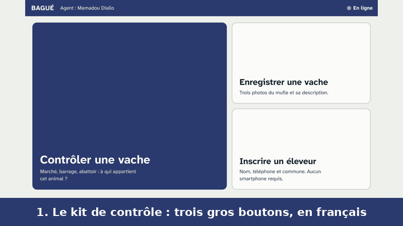
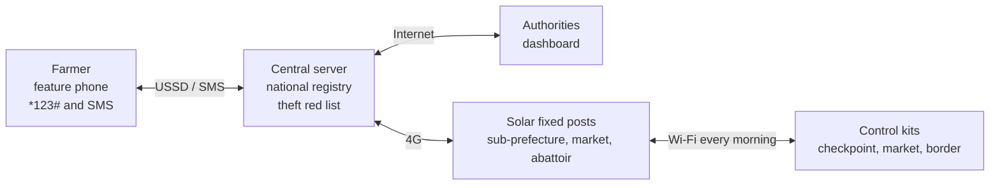
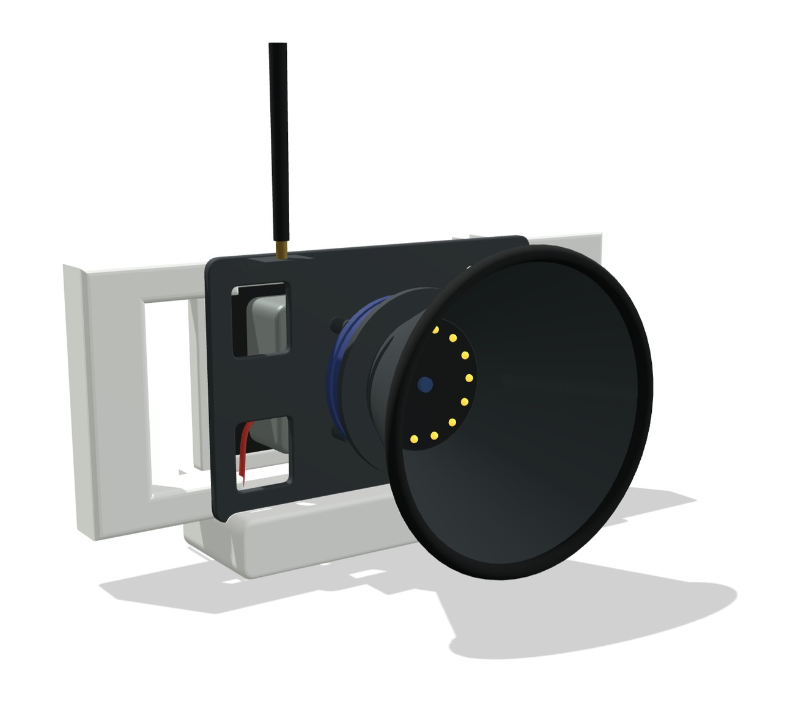
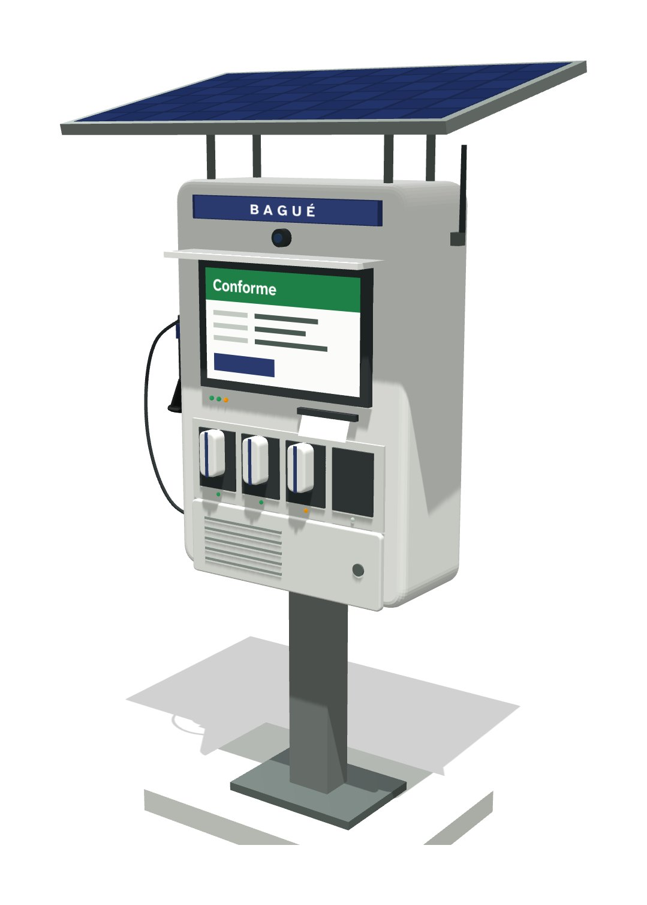
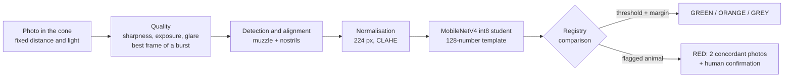

# BAGUÉ

**Identifying every head of cattle by its muzzle.** A national cattle anti-theft registry for Guinea, designed for field conditions: low-cost control kits, feature phones for farmers, and operation over weak networks.

[Version française](README.md)

  

**Website and live demo: [https://bague-guinee.github.io/bague-vitrine/](https://bague-guinee.github.io/bague-vitrine/)** — `*123#` demo and 3D hardware.

  

> This repository is the project's **public showcase**: overview, architecture, hardware, research method and ethics. Source code, AI models and data remain private.

---

## The problem

In Guinea, cattle theft is costly for herders and fuels conflict between communities. Brands and ear tags can be altered, cut or torn off: a stolen animal changes market within a day, with no proof of ownership.

## The idea

Each cow's **muzzle** carries a unique pattern of beads and ridges, like a fingerprint. It does not change with age and cannot be removed. A photo taken inside a lit cone becomes a **128-number template**, compared against the national registry.

## How it works

| Step | What happens |
| --- | --- |
| 1. Enrol | The agent registers the farmer, takes 3 muzzle photos and describes the animal. The kit issues a `BG-…` code and a QR code, sent by SMS. |
| 2. Check | At a market, checkpoint or abattoir, one photo is enough: **GREEN** compliant, **RED** reported stolen, **ORANGE** retake the photo, **GREY** not registered. |
| 3. Report a theft | The farmer dials `*123#` from any phone. The animal is flagged nationwide. |
| 4. Travel and sell *(planned)* | Signed travel certificate, verifiable offline; private sales confirmed by both parties. |

## Hardware

  
  

| Field kit | Fixed post |
| --- | --- |
| Raspberry Pi CM5, camera at the back of an LED-lit cone (fixed distance and lighting), touchscreen, 4G + GPS, removable battery pack. **About USD 165–250.** | 200 W solar + LiFePO4 battery, dual-SIM 4G router, 7" screen, thermal printer, charging station for 4 kits. **About USD 920–1,520.** |

These are **designs**: the first physical kit has not been assembled yet. Prices estimated from components, before quotes.

## Research

- **One processing pipeline** shared by the kit, the server and the experiments: the model sees in production exactly what it saw in training.
- **Learning**: a pretrained ConvNeXt-Nano teacher with an **AdaFace** head (quality-adaptive margin, suited to field photos) or ArcFace, plus a **Matryoshka** loss (the first 64 dimensions form a compact template for the QR code). It is then **distilled** into a MobileNetV4 student and **int8-quantised**; quantisation is rejected if it changes templates too much.
- **Decision**: a margin is required between the first and second candidate, and there is **no RED from a single photo** (the kit asks for a second photo; each photo and their fusion must point to the same animal). For national deployment, checks will move to **1:1 verification** of the claimed animal (code, card or QR) so false alerts stay rare across millions of animals; the demonstrator still searches the whole registry.
- **Evaluation protocol** (ISO/IEC 19795-1 vocabulary):
  - enrolment and probes from **different sessions**;
  - **never-enrolled** animals, to measure false alarms;
  - **subject-level confidence intervals** (bootstrap) and Wilson bounds;
  - error rates **per breed, age and device**;
  - thresholds set on validation, then applied unchanged to test;
  - every report opens with its own limitations.
- **Data**: collected with the kit itself over several sessions, with mandatory consent, no personal data in the training set, and an animal-level split checked for leakage.

## Results, unrounded

| What is measured | Result | Conditions |
| --- | --- | --- |
| Full system: kit, server, `*123#`, dashboard | Works end to end | Automated tests and demonstrator |
| Time to process one photo (quality check → template) | 6 ms median, 9 ms p95 | int8 student, 2-core x86 server CPU — **still to be measured on the CM5** |
| float32 vs int8 model agreement | Mean cosine 0.997–0.999 | Two synthetic-data trials |
| **Accuracy on real Guinean cattle** | **Not yet measured** | Field collection with a veterinarian has not started; the protocol is ready |

For reference, a recent study reports 96% on laboratory images but 81% on smartphone photos taken on farms ([Khalifa & Abdultawab, 2026](https://doi.org/10.1186/s12917-026-05948-0)). The cone and the Guinean data collection are meant to close that gap.

## Ethics

- **No one is accused by a machine**: a RED requires two concordant photos and human confirmation; doubt yields ORANGE, never a seizure.
- **Error rates are published** per breed, age and device; a gap between breeds blocks deployment.
- **Farmers stay in control**: consent, no names or phone numbers in research data, no tax use, right to withdraw.
- **Animals are respected**: a photo, no marking; the cone is disinfected between animals.

Full charter (French): [docs/ETHIQUE.md](docs/ETHIQUE.md).

## Team

| | Role |
| --- | --- |
| **Thierno Diallo** | Technology: recognition AI, kit, post and server software, architecture and security. Researcher in embedded AI (robust, energy-efficient AI for resource-limited settings), Prof. Hongpeng Wang's laboratory, Harbin Institute of Technology, Shenzhen. |
| **Mamadou Kandara Souaré** | Sales and operations in Conakry: relations with authorities, field testing, operation and deployment. |

## Citation

See [CITATION.cff](CITATION.cff), or GitHub's "Cite this repository" button.

## License

© 2026 The BAGUÉ project authors. **All rights reserved.** This repository is published for presentation purposes: you may view it, but not copy, modify or reuse it without written permission. See [LICENSE](LICENSE).
