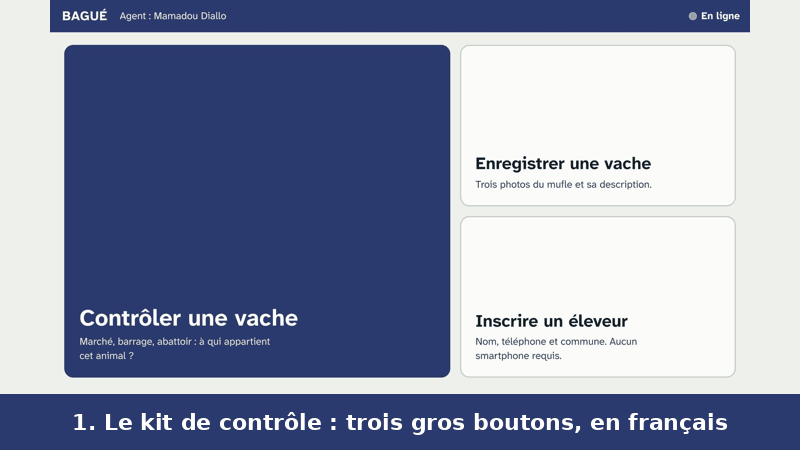
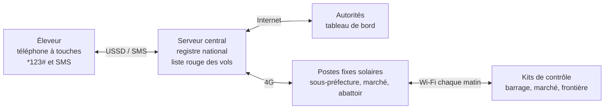
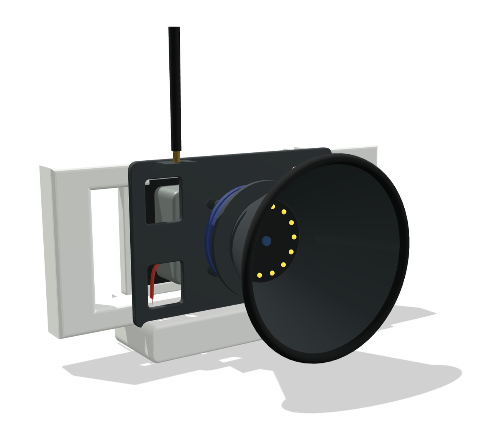
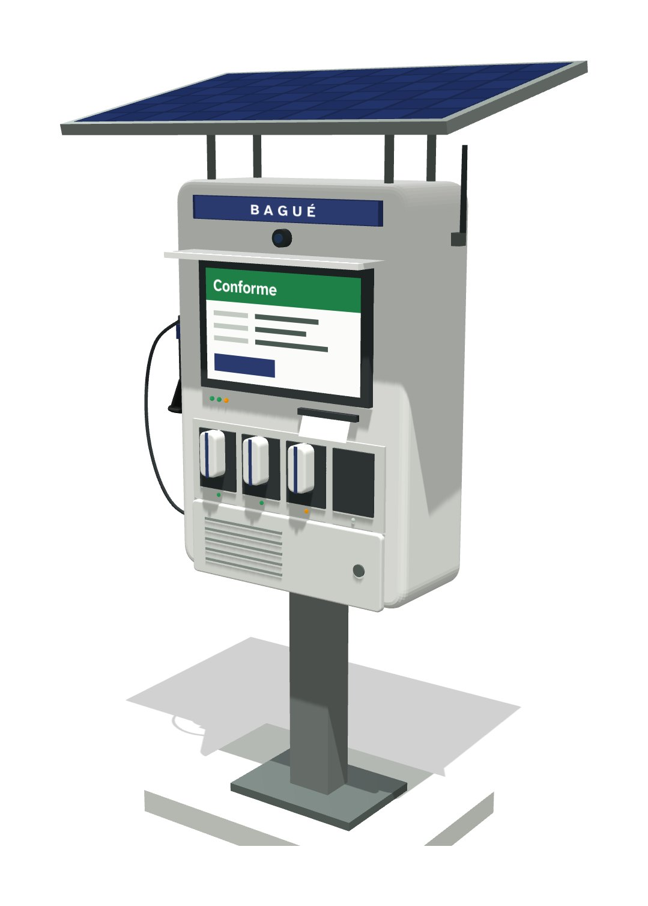
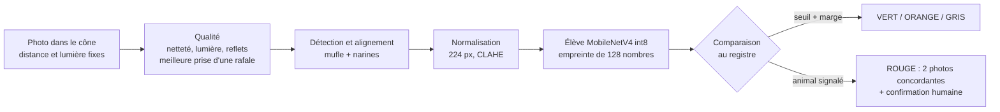

# BAGUÉ

**Identifier chaque bovin par son mufle.** Un registre national anti-vol du bétail pour la Guinée, pensé pour le terrain : kits de contrôle à bas coût, téléphone à touches pour l'éleveur, fonctionnement avec un réseau faible.

[English version](README.en.md)

  

**Site et démo en ligne : [https://bague-guinee.github.io/bague-vitrine/](https://bague-guinee.github.io/bague-vitrine/)** — démo `*123#` et matériel en 3D.

  

> Ce dépôt est la **vitrine publique** du projet : présentation, architecture, matériel, méthode de recherche et éthique. Le code source, les modèles d'IA et les données restent privés.

---

## Le problème

En Guinée, le vol de bétail coûte cher aux éleveurs et nourrit des conflits entre communautés. Le marquage au fer et les boucles d'oreille se modifient, se coupent ou s'arrachent : un animal volé change de marché en un jour, sans preuve de propriété.

## L'idée

Le **mufle** (le nez) de chaque vache porte des perles et des sillons uniques, comme une empreinte digitale. Il ne change pas avec l'âge et ne s'enlève pas. Une photo prise dans un cône éclairé devient une **empreinte numérique de 128 nombres**, comparée au registre national.

## Comment ça marche

| Étape | Ce qui se passe |
| --- | --- |
| 1. Enregistrer | L'agent inscrit l'éleveur, prend 3 photos du mufle et décrit l'animal. Le kit donne un code `BG-…` et un QR code, envoyés par SMS. |
| 2. Contrôler | Au marché, au barrage ou à l'abattoir, une photo suffit : **VERT** conforme, **ROUGE** signalé volé, **ORANGE** photo à refaire, **GRIS** non enregistré. |
| 3. Signaler un vol | L'éleveur compose `*123#` sur n'importe quel téléphone. L'animal passe en alerte dans tout le pays. |
| 4. Voyager et vendre *(prévu)* | Certificat de voyage signé, vérifiable sans réseau ; vente entre particuliers confirmée par les deux parties. |

## Le matériel

  
  

| Kit de terrain | Poste fixe |
| --- | --- |
| Raspberry Pi CM5 et écran tactile 7 pouces, caméra au fond d'un cône aimanté à LED (distance et lumière fixes), deux poignées avec bouton photo, batterie 20 000 mAh amovible. **Prototype : environ 400 USD.** | Solaire 200 W + batterie LiFePO4, routeur 4G double SIM, écran 7", imprimante thermique, station de recharge pour 4 kits. **Environ 920 à 1 520 USD.** |

Le **prototype du kit** (version 0.4.0) est en cours d'assemblage : composants achetés à Shenzhen, pièces imprimées en 3D. Le poste fixe est une **conception** ; prix estimé à partir des composants, avant devis. Planches techniques : [kit](docs/images/planche-kit.jpg), [poste](docs/images/planche-poste.jpg), [mallette](docs/images/planche-mallette.jpg).

## La recherche

- **Une seule chaîne** de traitement, partagée par le kit, le serveur et les expériences : le modèle voit en production exactement ce qu'il a vu à l'entraînement.
- **Apprentissage** : professeur ConvNeXt-Nano pré-entraîné, tête **AdaFace** (marge adaptée à la qualité de l'image, utile pour les photos de terrain) ou ArcFace, perte **Matryoshka** (les 64 premières dimensions forment une empreinte réduite pour le QR code), puis **distillation** vers un élève MobileNetV4 et **quantification int8**, refusée si elle modifie trop les empreintes.
- **Décision** : marge exigée entre le premier et le deuxième animal ; **pas de ROUGE sur une seule photo** (le kit demande une 2e photo, et chaque photo comme leur fusion doivent désigner le même animal). Pour le déploiement national, le contrôle passera en **1 contre 1** sur l'animal annoncé (code, carte ou QR), afin que les fausses alertes restent rares sur des millions d'animaux ; le démonstrateur compare encore à tout le registre.
- **Protocole d'évaluation** (vocabulaire ISO/IEC 19795-1) :
  - enrôlement et contrôle sur des **séances différentes** ;
  - animaux **jamais enregistrés**, pour mesurer les fausses alertes ;
  - **intervalles de confiance par animal** (bootstrap) et bornes de Wilson ;
  - erreurs **par race, âge et appareil** ;
  - seuils fixés sur la validation puis appliqués tels quels au test ;
  - chaque rapport commence par ses limites.
- **Données** : collecte avec le kit lui-même, en plusieurs séances, consentement obligatoire, aucune donnée personnelle dans le jeu d'entraînement, découpage par animal contrôlé contre les fuites.

Détails : [architecture technique](docs/ARCHITECTURE.md), [veille scientifique](docs/VEILLE-SCIENTIFIQUE.md), [fiche du modèle](docs/MODEL_CARD.md), [fiche des données](docs/DATASHEET.md).

## Résultats, sans arrondir

| Ce qui est mesuré | Résultat | Conditions |
| --- | --- | --- |
| Chaîne complète : kit, serveur, `*123#`, tableau | Fonctionne de bout en bout | Tests automatiques et démonstrateur |
| Temps de calcul d'une photo (contrôle qualité → empreinte) | 6 ms (médiane), 9 ms (95 %) | Élève int8, processeur serveur x86 2 cœurs — **reste à mesurer sur le CM5** |
| Écart entre modèle float32 et int8 | Cosinus moyen 0,997 à 0,999 | Deux essais sur données synthétiques |
| **Précision sur de vraies vaches guinéennes** | **Pas encore mesurée** | La collecte avec un vétérinaire n'a pas commencé ; le protocole est prêt |

Pour comparaison, une étude récente obtient 96 % sur des images de laboratoire mais 81 % sur des photos de smartphone prises en ferme ([Khalifa et Abdultawab, 2026](https://doi.org/10.1186/s12917-026-05948-0)). C'est cet écart que le cône et la collecte en Guinée doivent réduire.

## Éthique

- **Personne n'est accusé par une machine** : un ROUGE demande deux photos concordantes et une confirmation humaine ; un doute donne ORANGE, jamais une saisie.
- **Les erreurs sont publiées**, par race, par âge et par appareil ; un écart entre races bloque le déploiement.
- **Les éleveurs gardent la main** : consentement, pas de nom ni de téléphone dans les données de recherche, aucun usage fiscal, droit de retrait.
- **Les animaux sont respectés** : une photo, sans marquage ; le cône est désinfecté entre deux animaux.

Charte complète : [docs/ETHIQUE.md](docs/ETHIQUE.md) · [formulaire de consentement](docs/CONSENTEMENT.md).

## Où en est le projet

- [x] Architecture nationale : kits, postes, USSD, certificats de voyage
- [x] Démonstrateur complet testé de bout en bout
- [x] Design du kit, du poste et de la mallette (2D et 3D)
- [x] Chaîne d'entraînement, de distillation et de quantification ; protocole d'évaluation
- [ ] Premier kit physique et réglage du cône
- [ ] Avis éthique et collecte de photos de 1 500 à 3 000 vaches avec un vétérinaire
- [ ] Entraînement du modèle sur des mufles guinéens et publication des résultats
- [ ] Pilote sur le terrain

## L'équipe

| | Rôle |
| --- | --- |
| **Thierno Diallo** | Technologie : IA de reconnaissance, logiciel des kits, des postes et du serveur, architecture et sécurité. Chercheur en IA embarquée (IA robuste et économe en énergie pour les milieux aux ressources limitées), laboratoire du Pr Hongpeng Wang, Harbin Institute of Technology, Shenzhen. |
| **Mamadou Kandara Souaré** | Ventes et opérations à Conakry : présentation aux autorités, tests sur le terrain, exploitation et déploiement. |

### Encadrement scientifique

Ce travail de recherche est encadré par le **Pr Hongpeng Wang** (School of Computer Science and Technology, Harbin Institute of Technology, Shenzhen), qui guide la méthode de recherche et le protocole d'évaluation.

## Citer ce projet

Voir [CITATION.cff](CITATION.cff), ou le bouton « Cite this repository » de GitHub.

## Licence

© 2026 Les auteurs du projet BAGUÉ. **Tous droits réservés.** Ce dépôt est publié pour présenter le projet : vous pouvez le consulter, mais pas le copier, le modifier ni le réutiliser sans accord écrit. Voir [LICENSE](LICENSE).
